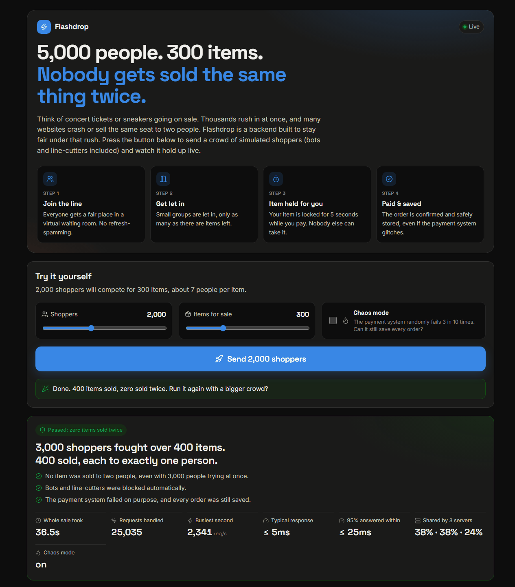
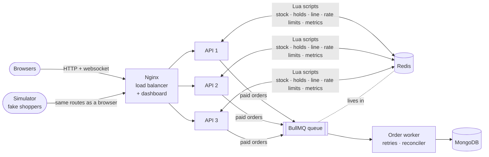
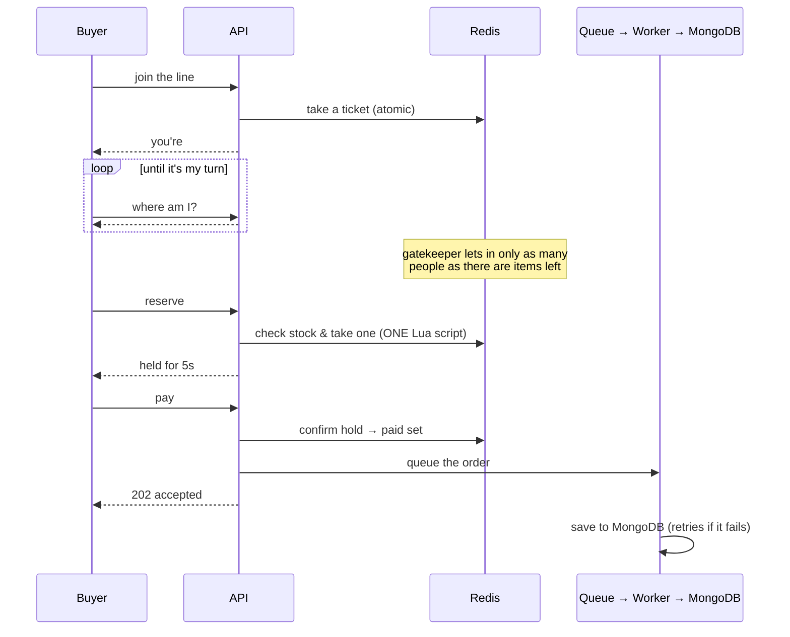
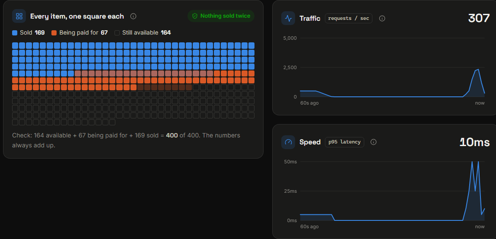

# ⚡ Flashdrop

**A limited-drop engine that survives a stampede.** Thousands of people, a few hundred items, and nobody gets sold the same thing twice.

Think concert tickets or sneaker drops: everyone rushes in at the same second. Many sites crash, or worse, sell the same seat to two people. Flashdrop is the backend built to stay fair and fast under that rush, plus a live dashboard where you can **unleash a crowd of simulated shoppers** (bots and line-cutters included) and watch it hold up.

**Live demo: [flashdrop-f62a.onrender.com](https://flashdrop-f62a.onrender.com)** · runs on Render's free plan, so the first visit can take up to a minute to wake the server (see [limits](#running-on-a-free-server))



## What it proves

- **Zero overselling.** Every run, every test, under every failure I could throw at it: 0 items sold twice.
- **Fair under abuse.** A virtual waiting room, per-IP and per-user rate limits. Bots spamming the buy button and people skipping the line are blocked automatically.
- **No lost orders.** The payment step can fail 30% of the time on purpose (chaos mode) and every paid order still lands in the database.
- **Scales horizontally.** Nginx in front of 3 identical API servers. One can crash mid-sale and the sale carries on.

## Benchmarks

All measured on one laptop (8 logical CPUs, Docker Desktop), with the load generator running on the **same machine**. So these numbers are a floor, not a ceiling.

### 1 server vs 3 servers behind Nginx

Same simulated crowd (90% normal shoppers, 5% spam bots, 5% line-skippers), same code.

| Crowd | API servers | Typical response (p50) | 95% answered within (p95) | Oversold |
|---|---|---|---|---|
| 3,000 buyers / 400 items | 1 | ≤ 50 ms | ≤ 250 ms | 0 |
| 3,000 buyers / 400 items | **3** | **≤ 5 ms** | **≤ 100 ms** | 0 |
| 5,000 buyers / 1,000 items | 1 | ≤ 100 ms | ≤ 250 ms | 0 |
| 5,000 buyers / 1,000 items | **3** | **≤ 5 ms** | **≤ 50 ms** | 0 |

Load split across the 3 servers: 33% / 34% / 33%.

### Server-driven polling

People in a waiting room keep asking "is it my turn?". If everyone asks every second, 5,000 people = 5,000 requests/second of pure waiting. Now the server tells each client when to ask again: front of the line every 1s, back of the line up to every 5s (never more than ¼ of the admission window, so nobody misses their turn).

| 3,000 buyers / 400 items, 3 servers | Requests | p95 | Shoppers who missed their turn |
|---|---|---|---|
| Everyone polls every ~1s | 61,902 | ≤ 100 ms | 0 |
| Server-driven polling | **25,566 (−59%)** | **≤ 25 ms** | **0** |

### k6 load test (independent of my own simulator)

[`k6/drop-test.js`](k6/drop-test.js): every virtual user is one buyer doing the full journey (join → wait → reserve → pay), arriving faster and faster, each from a different IP. The test **fails** unless p95 < 300 ms, server errors < 1%, and the server's own stats show 0 oversold.

| Peak arrival | Buyers | Requests | p95 | Failed requests | Sold | Oversold |
|---|---|---|---|---|---|---|
| 150 buyers/s | 4,023 | 8,137 | 8.9 ms | 0% | 1,000 / 1,000 | 0 ✅ |
| 500 buyers/s | 12,483 | 21,499 | 6.6 ms | 0% | 1,000 / 1,000 | 0 ✅ |

### Failure tests (5,000 buyers)

| What I did mid-sale | Result |
|---|---|
| `docker compose kill api2` (crash) + payment chaos on | 1,000 sold, 0 oversold, every order saved. 5 of ~82,000 requests got a 502: the ones api2 had already received when it died (Nginx retries safe requests elsewhere but never re-sends a purchase it can't confirm). |
| `docker compose stop api2` (planned restart / deploy) | **0 errors.** Graceful shutdown: stop taking connections, finish in-flight requests, then exit. |
| Kill the order worker mid-run | Unfinished jobs are picked up by the next worker (stalled-job recovery). |
| Payment provider fails 30% of attempts | Retries with exponential backoff; all orders saved. |
| Paid in Redis but the job never got queued | The reconciler finds it within 5s and re-queues it. |

## Architecture



**Why it can scale:** the API servers keep nothing important in memory. Stock, holds, the waiting line, rate-limit buckets and metrics all live in Redis, so any request can go to any server.

### A buyer's journey



## How it was built: break it first, then fix it

Each step started by showing the naive version failing.

| Step | The problem | The fix |
|---|---|---|
| 1 | Read stock → check → write: 500 buyers on 100 items **sold 400 items that didn't exist** | One atomic conditional update (`findOneAndUpdate` with `$gt`/`$inc`): 0 oversold |
| 2 | MongoDB per click is slow, and people need time to pay | Redis Lua scripts: check-and-hold in one step, holds expire and a sweeper returns the item |
| 3 | Payment + email are slow and flaky | Answer `202` instantly, BullMQ worker does the slow part: idempotent upserts, retries with backoff, stalled-job recovery, a reconciler as a safety net |
| 4 | Bots and refresh-spammers | Waiting room (ticket + sorted set) and a gatekeeper that admits only as many people as items left; token-bucket rate limits per IP and per user |
| 5 | "Trust me, it works" isn't convincing | A simulator that plays thousands of shoppers through the real HTTP routes, and a live Socket.IO dashboard. Latency stored as histograms so numbers from many servers can be added up |
| 6 | One Node process tops out | Docker Compose: Nginx (least connections) + 3 APIs, correct client IPs behind the proxy, graceful shutdown |
| 7 | Waiting-room polling is most of the traffic; is it deployable? | Server-driven polling (−59% requests), k6 tests, admin routes locked down, CORS, Render blueprint |

## Run it

**Everything (Nginx + 3 APIs + worker + simulator + Redis + Mongo):**

```bash
docker compose up -d --build
# open http://localhost:8080 and press "Send shoppers"
```

**Benchmark from the terminal:**

```bash
cd server
npm run bench -- http://localhost:8080 5000 1000          # buyers, items
npm run bench -- http://localhost:8080 3000 400 --chaos   # with payment failures
```

**k6:**

```bash
docker run --rm -i --network flashdrop_default -v "$PWD/k6:/scripts" \
  -e BASE_URL=http://nginx -e PEAK_BUYERS_PER_SEC=500 grafana/k6:2.4.0 run /scripts/drop-test.js
```

**Local development** (hot reload, dashboard on :5174):

```bash
docker compose up -d mongo redis
cd server && npm install
npm run dev          # API on :4000
npm run worker       # order worker
npm run simulator    # fake shoppers
cd ../client && npm install && npm run dev   # http://localhost:5174
```

**The step-by-step demos** (local dev, API on :4000):

```bash
npm run stampede -- --mode naive  --buyers 500 --stock 100   # watch it oversell
npm run stampede -- --mode atomic --buyers 500 --stock 100   # 0 oversold
npm run demo:drop     # reservations + holds expiring
npm run demo:queue    # worker, retries, crash recovery
npm run demo:line     # waiting room, bots, line-skippers
```

## Running on a free server

The live demo runs entirely on free plans: **Render** (dashboard as a static site, API as a web service, Render Key Value as Redis) and **MongoDB Atlas M0**. Render's free plan has no free background workers, so the API, worker and simulator run in one process ([`all-in-one.js`](server/src/all-in-one.js)). Locally they're separate processes, which is how you'd run real traffic.

The free web service has **0.1 CPU** and sleeps after 15 idle minutes (about a minute to wake up; the dashboard says so). I tested that exact limit in Docker (`--cpus 0.1 --memory 512m`):

| Crowd on 0.1 CPU | Sold | Oversold | p95 |
|---|---|---|---|
| 200 buyers / 40 items | 40 / 40 | 0 | ≤ 2.5 s |
| 500 buyers / 100 items | 94 / 100 (overloaded) | 0 | ≤ 2.5 s |

So the live demo caps the crowd at 200. Even overloaded, it never oversold.

**On the real Render free server** (200 buyers / 40 items): 40 / 40 sold, 0 oversold, p95 ≤ 250 ms, 2,540 requests, bots and line-skippers blocked. Render lets short bursts go above the 0.1 CPU baseline, so the live demo does better than my worst-case Docker test.

### Deploy your own

1. **MongoDB Atlas:** create a free M0 cluster, a database user, and allow access from anywhere (`0.0.0.0/0`, since Render's free plan has no fixed IP). Copy the connection string and add a database name, e.g. `.../flashdrop?retryWrites=true`.
2. **Render:** New → Blueprint → pick this repo. [`render.yaml`](render.yaml) creates the dashboard, the API and Redis. Paste the Atlas string when asked for `MONGO_URL`.
3. Render gives each service a random public URL (`flashdrop-xxxx.onrender.com`). Put yours into `CORS_ORIGIN` and `VITE_API_URL` in `render.yaml` and push. (Render's `host` property is the internal name, not the public URL, so it can't be wired automatically.)
4. Open the dashboard URL and press **Send shoppers**.
5. Check the real client IP is detected: open `https://<api>.onrender.com/health`. `yourIp` should be your own IP. Render sits behind Cloudflare, so `TRUST_PROXY` includes Cloudflare's published ranges.

Admin routes (create/reset a drop) need the `ADMIN_TOKEN` Render generates; without a token they're disabled in production.

## Project structure

```
server/
  src/
    index.js            API (Express 5)
    worker.js           order worker (BullMQ)
    simulator.js        fake shoppers, through the real HTTP routes
    all-in-one.js       all three in one process (free hosting)
    lua/                atomic Redis scripts: reserve, confirm, sweep, join, admit, status, token bucket
    routes/             drops (buyer flow), simulations, admin
    reconciler.js       finds paid orders that never got saved
    gatekeeper.js       lets people out of the waiting room
    metrics.js          per-second counters + latency histograms in Redis
    live.js             Socket.IO feed for the dashboard
    lifecycle.js        graceful shutdown for every part
  scripts/              stampede + demos + bench
client/                 React 19 + Vite dashboard (hand-made SVG charts, lucide icons)
nginx/                  load balancer config + image that also serves the dashboard
k6/                     load test with pass/fail thresholds
render.yaml             free deployment blueprint
docker-compose.yml      the whole system on one machine
```

## Stack

Node.js 24 · Express 5 · Redis (Lua scripts) · BullMQ · MongoDB / Mongoose · Socket.IO · React 19 · Vite · Nginx · Docker Compose · k6 · Render


